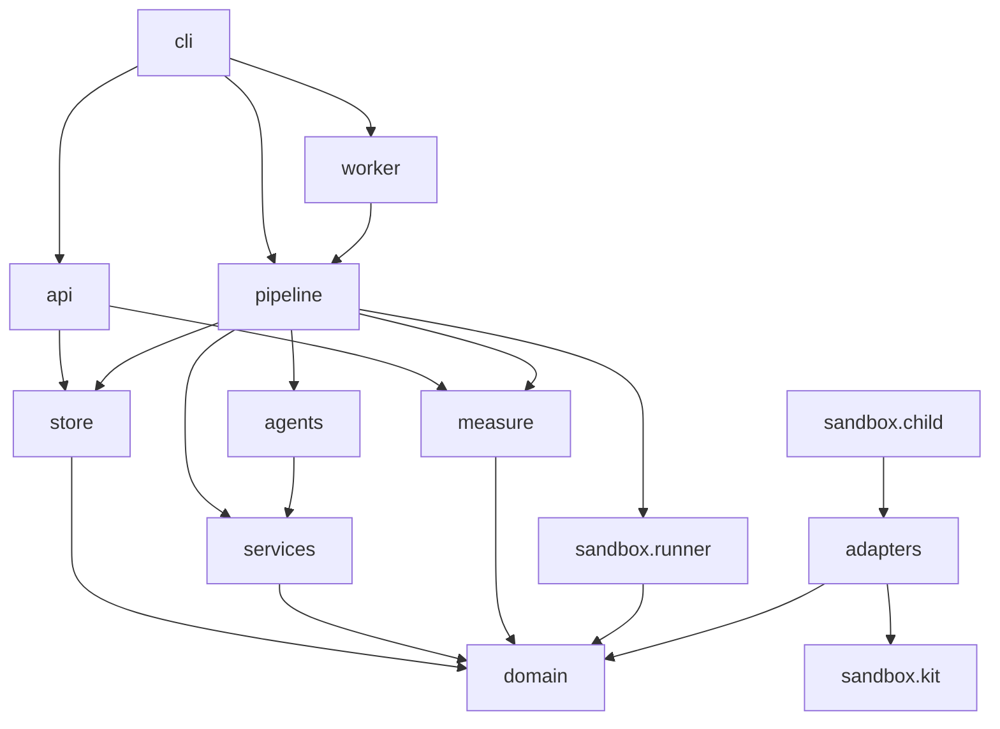

# Components

One doc per part of the system. Each lists its modules and public functions in one line each.
Function lists are the **plan** at stage 0; each stage updates the doc of every component it
touches, in the same commit as the code.

Python package `src/sourcemap/`, web UI in `web/`.

| Component | Package | Doc | Pure? |
|---|---|---|---|
| Domain types | `sourcemap.domain` | [domain-types.md](domain-types.md) | yes |
| Measuring rules | `sourcemap.measure` | [measure.md](measure.md) | yes |
| Store | `sourcemap.store` | [store.md](store.md) | no (SQLite, files) |
| Services | `sourcemap.services` | [services.md](services.md) | no (Telem, OpenRouter) |
| Sandbox + adapters | `sourcemap.sandbox`, `sourcemap.adapters` | [sandbox-and-adapters.md](sandbox-and-adapters.md) | no (child process, HTTP) |
| Agents | `sourcemap.agents` | [agents.md](agents.md) | no (Claude Agent SDK) |
| Pipeline + worker | `sourcemap.pipeline`, `sourcemap.worker` | [pipeline.md](pipeline.md) | no |
| API + web UI | `sourcemap.api`, `web/` | [api-and-web.md](api-and-web.md) | no (HTTP server) |
| CLI | `sourcemap.cli` | [pipeline.md](pipeline.md#cli) | entry point |

## Layering

Arrows mean "may import". Enforced by import-linter contracts in `pyproject.toml`; a contract is
never loosened to make an import work — the code moves instead.

Contracts:

1. **Pure core.** `sourcemap.domain` and `sourcemap.measure` import no `sqlite3`, `httpx`,
   `requests`, `openai`, `claude_agent_sdk`, `subprocess`, or any other `sourcemap` package
   except `domain`. Time is passed in as an argument, never read from a clock.
2. **API is read-only on the world.** `sourcemap.api` must not import `pipeline`, `worker`,
   `services`, `agents`, `sandbox` or `adapters`.
3. **Adapters stay in the child.** Only `sourcemap.sandbox.child` may import `sourcemap.adapters`.
   Adapters may import only `sourcemap.sandbox.kit` and `sourcemap.domain`.
4. **Layers:** `cli/worker/api` > `pipeline` > `agents/services/sandbox.runner/store` > `measure` > `domain`.
5. **Environment.** Only `sourcemap.cli` reads `.env`/`os.environ`; it passes settings down.
