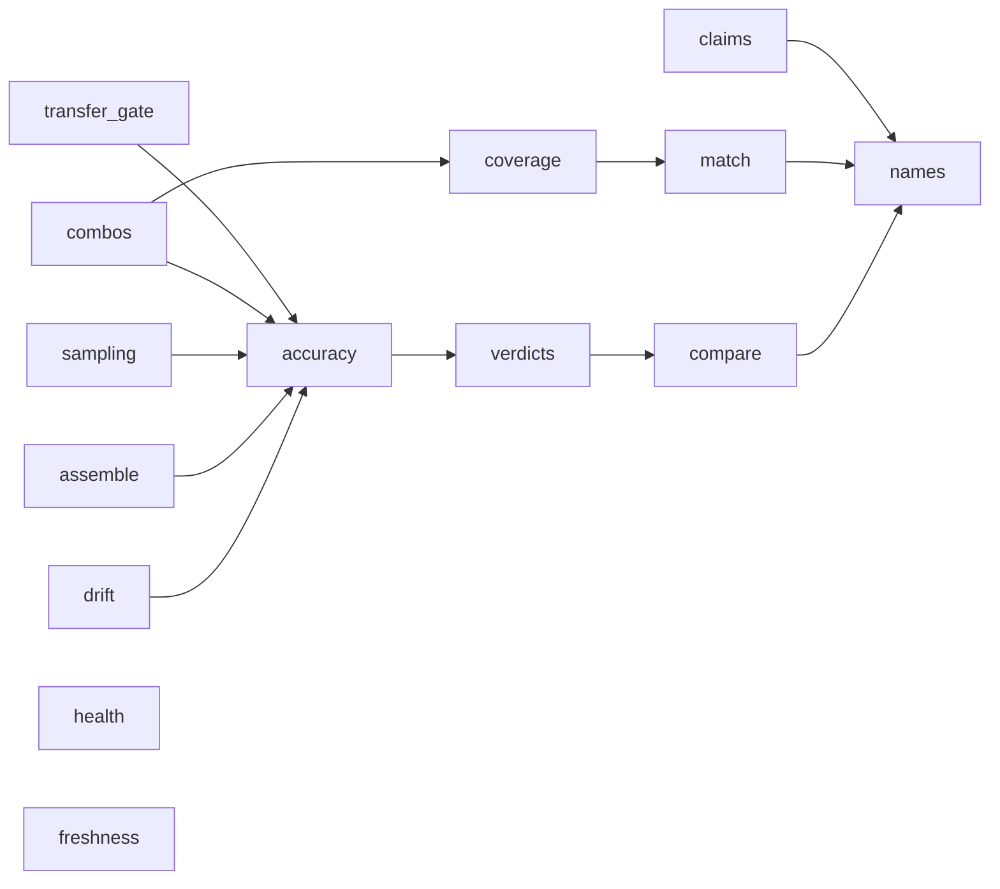

# Measuring rules — `sourcemap.measure`

The pure heart of the product: every rule in `docs/domain.md` §6–§9 lives here. No database,
network, model, clock or unseeded randomness. Anything that needs a model (borderline names,
title comparison) is returned as a **question** for the caller to ask the judge, and the answer
is passed back in. Tested with plain data; the accuracy case table is the specification.

| Module | Public functions (one line each) |
|---|---|
| `claims.py` | `extract_claims(spec, record) -> list[ClaimDraft]` — split a record into claims by the data type's rules. |
| `names.py` | `normalise_name(s) -> NormName` — fold, strip accents/honorifics/suffixes, reorder "Last, First", sort tokens; `script_of(s)` — Latin/Hangul/other. |
| `match.py` | `match_mentions(mentions, decisions) -> MatchResult` — group mentions of one probe unit into entities by identifier and rules, return borderline pairs as judge questions, honour cannot-link; `match_quality(result, known_pairs) -> MatchQuality` — false/missed merges on identifier-known pairs. |
| `compare.py` | `compare_values(claim_type, a, b) -> Same / Different / AskJudge` — exact, normalised, or a judge question. |
| `verdicts.py` | `reference_verdict(claim, reference_claims)`, `lookup_verdict(claim, judge_answer, as_of)`, `agreement_verdict(claim, others)`; `current_verdict(verifications, as_of)` — strongest unexpired wins (R7); `allowed_verifier(source, verifier, claim_type) -> bool` — the lineage rule (R4). |
| `accuracy.py` | `prior_for(tier) -> (a, b)`; `estimate(verdicts, prior, min_decisive=5) -> AccuracyEstimate` — weighted Beta posterior, mean, 90% interval, state, stale/unverifiable shares (R6, R8). |
| `transfer_gate.py` | `features(claims) -> Features` — fill rate, tree depth, freshness, formats; `representative(overlap, rest) -> GateResult` — R5. |
| `coverage.py` | `coverage(source, segment, records, claims) -> Coverage` — state, units covered, unique entities. |
| `combos.py` | `best_combo(segment, scores, entities_by_source, k=3) -> Combo` — union of unique entities; `is_gap(combo, target)`. |
| `sampling.py` | `pick_lookups(cells, claims, budget_units, seed) -> list[ClaimId]` — widest intervals first, then oldest verdicts; seeded. |
| `freshness.py` | `expires_at(claim_type, decided_at)`; `due_for_recheck(verifications, as_of, share) -> list` — oldest first. |
| `health.py` | `source_health(prev_stats, this_stats) -> HealthState`. |
| `drift.py` | `drift_alert(prev_interval, new_interval) -> bool` — true when they don't overlap. |
| `assemble.py` | `choose_value(entity, claim_type, claims, scores) -> Choice` — winner by accuracy for that segment and claim type, with alternatives and the reason. |
