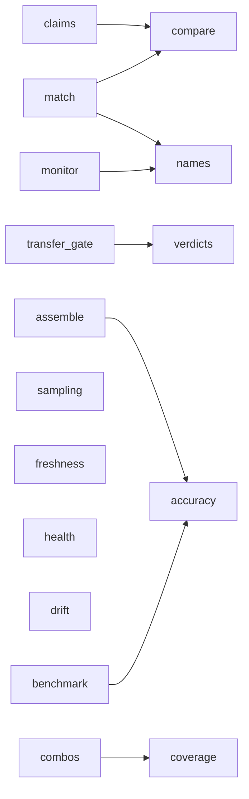

# Measuring rules — `sourcemap.measure`

The pure heart of the product: every rule in `docs/domain.md` §6–§11 lives here. No database,
network, model, clock or unseeded randomness (import-linter contract "Pure core"; time is passed in;
`random.Random(seed)` only). Anything that needs a model (borderline names, title comparison) is
returned as a `JudgeQuestion` for the caller to ask; the stored answer is passed back in later.
Case tables in `tests/cases/` are the specification. Stage 1: 195 tests.

| Module | Public functions and types (one line each) |
|---|---|
| `names.py` | `normalise_name(s) -> NormName(tokens, initials, full, script, key)` — fold case/accents, drop honorifics and suffixes, split on space/hyphen/comma, sort; Hangul kept whole. `script_of(s)` — latin / hangul / mixed / other. |
| `compare.py` | `normalise_text`, `normalise_url`, `normalise_value(spec, v)` — comparable form by value kind; `compare_values(spec, a, b) -> Comparison` (SAME / DIFFERENT / ASK_JUDGE; judge-mode types never return DIFFERENT); `judge_question(spec, a, b, **ctx) -> JudgeQuestion`. |
| `claims.py` | `extract_claims(spec, record) -> list[ClaimDraft]` — one claim per person per claim type with a value; existence claims always; `reports_to` only when the manager is in the same record; `fingerprint(source, unit, entity, claim_type, value_norm)` — stable sha1. |
| `match.py` | `match_mentions(new, existing, decisions, next_entity_id) -> MatchResult(assignments, new_entities, merges, judge_questions, splits_needed)` — ADR 0004 + 0013 order, cannot-link, stable ids, older id survives merges; `name_relation(a, b)` — same / different / borderline; `strip_identifiers`, `known_pairs_from_identifiers`, `match_quality(result, known_pairs) -> MatchQuality(pairs, false_merges, missed_merges)`. |
| `verdicts.py` | `allowed_verifier(source, verifier, claim_type)` — R4; `method_weight(method, source)` — R7 weights; `reference_verdict`, `lookup_verdict`, `agreement_verdict` — build verdicts (None when the lineage rule forbids or undecided; disagreement is not `wrong`); `current_verdict(vs, as_of)` — strongest unexpired wins; `is_valid`; `exclude(v, reason)`. |
| `accuracy.py` | `prior_for(tier)`; `beta_interval(a, b) -> Interval` (90%); `estimate(verdicts, prior, min_decisive=5) -> AccuracyEstimate(state, mean, interval, counts, n_decisive, n_weighted, shares, prior, posterior, posterior_mean)` — ADR 0002. |
| `transfer_gate.py` | `features(claims: ClaimInfo…) -> Features(fill_rate, mean_depth, median_age_days, format_signature)`; `representative(overlap, rest, tol) -> GateResult(passed, reasons)`; `apply_gate(overlap_verdicts, gate)` — R5. |
| `coverage.py` | `coverage(panel, outcomes: {unit: UnitOutcome}, *, has_adapter, offered, claim_type=None) -> Coverage(state, reason, units_covered, units_panel, units_failed, units_not_fetched, entities, ratio, label)` — failed and not-fetched units leave the denominator. |
| `combos.py` | `best_combo(segment_units, coverage_by_source, k=3) -> Combo(sources, units_covered, entities, ratio)` — union of units and unique entities; `is_gap(combo, target=0.5)`. |
| `assemble.py` | `choose_value(claim_type, candidates: Candidate…) -> Choice(winner, winner_sources, alternatives, reason)` — measured accuracy, then interval only, then tier prior; `reason["basis"]` says which decided. |
| `sampling.py` | `pick_lookups(cells, claims_by_cell, already_valid, budget_n, seed=0)` — widest intervals first (unmeasured = 1.0), round-robin, skip valid verdicts. |
| `freshness.py` | `expires_at(spec, decided_at)`; `is_due(v, as_of, window=0.2)`; `due_for_recheck(verifications, as_of, budget_n, window=0.2)` — oldest first (ADR 0012). |
| `health.py` | `RunStats(units_attempted, units_failed, shape_failures, units_valid, fingerprints)`; `changed_share(prev, this)`; `source_health(prev, this) -> HealthState` — broken > shape_changed > degraded > changed > ok. |
| `drift.py` | `drift_alert(prev, new) -> bool` — true only when both intervals exist and don't overlap. |
| `benchmark.py` | `normalise_url`, `registrable_domain`, `candidate_key`; `score_known_answer(expected, hits) -> (hit, rank)`; `to_candidates(hits: Hit…) -> list[Candidate]`; `review_sample(candidates, cap=80, seed)`; `provider_metrics(providers, trials, candidates, known_keys, kept_keys, reviewed_keys, calls, segment=None) -> list[ProviderMetric]` — ADR 0015. |
| `monitor.py` | `match_hits(hits: NewsHit…, entities: TrackedEntity…) -> list[MonitorMatch]` — all full name tokens in the hit, names of ≥ 2 tokens (or a Hangul name of ≥ 2 syllables) only; `prioritise(queue, matches, claims_by_entity, share_cap)` — ADR 0016. |
