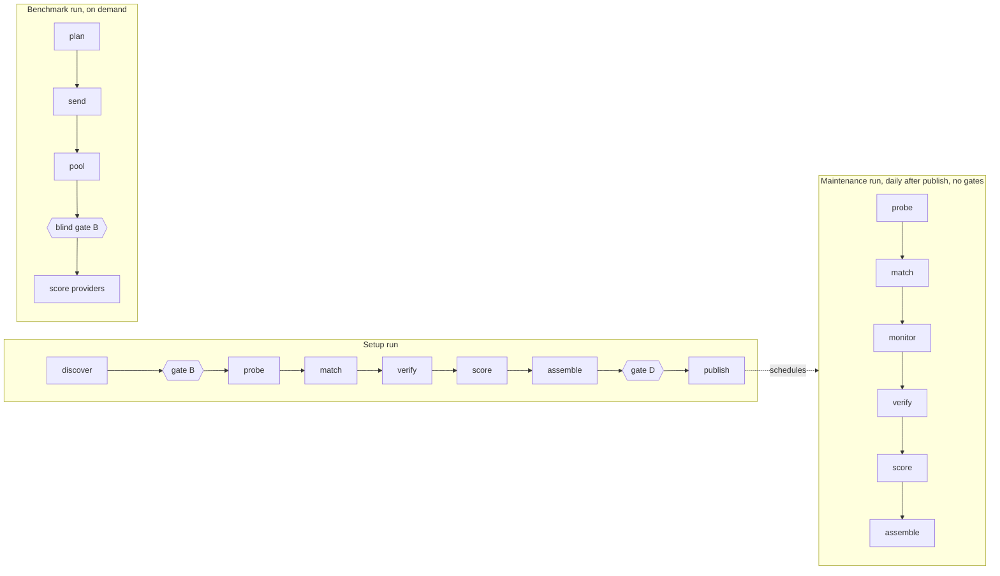

# Pipeline and worker — `sourcemap.pipeline`, `sourcemap.worker`

The worker leases jobs from the database and runs one stage per job. A stage reads its inputs
from the database, does its work per unit, writes each unit's result before the next, and checks
for cancellation and budget between units. Restarting a stage skips units already done, so a
crash resumes from the last stage (ADR 0011).

Gate D exists only at the end of a setup run (`docs/domain.md` step 8). Discovery runs are on demand
only. Simulated runs (ADR 0014) use the same stages against a copy of the database.

| Module | Public functions (one line each) |
|---|---|
| `pipeline/idcheck.py` (stage 2) | `check_identifier(kind, value, unit_name, *, fetch, dart_key, aliases, others) -> (result, detail)` — theorg page title, LinkedIn URL shape only, DART company API, ROR names, OpenAlex's ROR, people page text; the DART key never enters a detail; `run_checks(conn, fetch, *, now, dart_key) -> rows` — every identifier of every unit into `identifier_check`; `known_answers(conn)` — latest passing (unit, kind, value); `unit_terms(name, identifiers)` — company name, or institution name + acronym. |
| `pipeline/runs.py` | `stages_for(kind) -> list[str]`; `advance(run)` — enqueue the next stage or wait at a gate. |
| `pipeline/discover.py` | `run(ctx)` — discovery agent → proposed sources + offers; then wait at gate B. |
| `pipeline/benchmark.py` | `plan(ctx)` — known-answer queries from passing identifiers + the discovery agent's fixed open query plan; estimated cost and review count; `send(ctx)` — every query to every provider pinned + auto routing, randomised order, cached; `known_answers(ctx)` — score trials automatically; `pool(ctx)` — candidates, review sample (≤ 80), then wait at a **blind** gate B; `score(ctx)` — `measure.benchmark.provider_metrics` → `benchmark_result` (ADR 0015). |
| `pipeline/inline.py` | `run_inline(run_id)` — execute a run's queued jobs in the CLI process with the same stage code, stopping at gates (used before the worker exists, and for dev). |
| `pipeline/review.py` | `export_csv(run) -> str` — blind rows, random order, no provider/rank/query; `import_csv(run, text)` — validate and record decisions; `review_terminal(run)`. |
| `pipeline/monitor.py` | `run(ctx)` — inside maintenance, before verify: one news search per company, `measure.monitor.match_hits`, save `monitor_hit`, reorder re-checks (ADR 0016). |
| `pipeline/probe.py` | `run(ctx)` — for each approved source × offered panel unit: reuse a fresh raw fetch or call the adapter; save raw fetches, records, mentions; claim drafts; health per source. |
| `pipeline/match.py` | `run(ctx)` — load existing entities of each probe unit, `measure.match_mentions` new mentions against them (ADR 0013), borderline pairs to the judge, apply merges/splits with `entity_event` rows; attach claims to entities (upsert by fingerprint). |
| `pipeline/verify.py` | `run(ctx)` — reference and agreement verdicts for all claims; lookups for the claims `measure.sampling` picks within budget; re-checks due by `measure.freshness`; R9 spot-checks of tier-1 sources; second-judge calibration sample. |
| `pipeline/extract_page.py` | `extract_people(raw_html, unit) -> Record` — judge-based extraction for first-party pages (ADR 0006). |
| `pipeline/score.py` | `run(ctx)` — compute scores, transfer gate, coverage, combos, gaps, health, drift alerts; save scores, `score_verification` links and the map snapshot. |
| `pipeline/assemble.py` | `run(ctx)` — `measure.assemble.choose_value` per entity and claim type; in setup runs only, prepare the gate D sample. |
| `pipeline/simulate.py` | `fork_db(scenario) -> path`; `fabricate(scenario, real_raw_fetch, as_of) -> SimulatedFetch` — edited copy flagged `simulated` with its patch (ADR 0014). |
| `pipeline/context.py` | `RunContext` — run row, settings, store, services, budget, `as_of` clock, cancellation check. |
| `pipeline/schedule.py` | `due_runs(schedules, now) -> list` — daily maintenance only. |
| `worker/main.py` | `serve(settings)` — loop: lease job → run stage → finish/fail; heartbeat; scheduler tick. |

## CLI

`sourcemap.cli` is the only entry point that reads `.env`. Commands: `seed`, `worker`, `api`,
`run <kind> <data_type> [--mode test|real] [--as-of DATE] [--replay]` (kinds include `benchmark`),
`benchmark plan <data_type>` (show query plan, providers, estimated cost and expected review count before sending),
`run … --inline` / `resume <run> --inline`, `review export|import <run>`, `review <run>` (terminal),
`seed --check-ids`,
`leaderboard [--segment]`, `status <run>`,
`approve <run> <gate>`, `map <data_type> [--claim-type]`, `trace <score_id|verification_id>`,
`adapter <source> <unit>` (dev: run one adapter on one unit), `sim <scenario> [--days N]`
(run a scenario in a database copy, ADR 0014).
