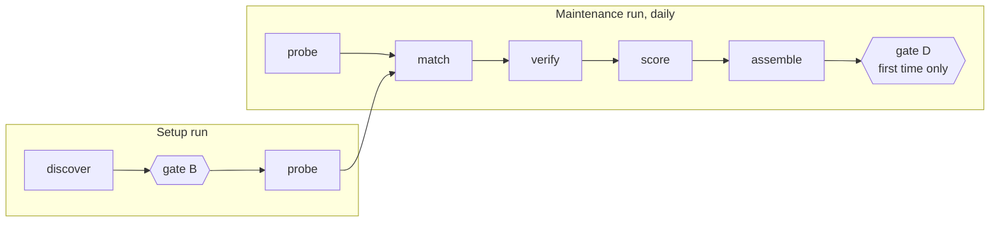

# Pipeline and worker — `sourcemap.pipeline`, `sourcemap.worker`

The worker leases jobs from the database and runs one stage per job. A stage reads its inputs
from the database, does its work per unit, writes each unit's result before the next, and checks
for cancellation and budget between units. Restarting a stage skips units already done, so a
crash resumes from the last stage (ADR 0011).

| Module | Public functions (one line each) |
|---|---|
| `pipeline/runs.py` | `stages_for(kind) -> list[str]`; `advance(run)` — enqueue the next stage or wait at a gate. |
| `pipeline/discover.py` | `run(ctx)` — discovery agent → proposed sources + offers; then wait at gate B. |
| `pipeline/probe.py` | `run(ctx)` — for each approved source × offered panel unit: reuse a fresh raw fetch or call the adapter; save raw fetches, records, mentions; claim drafts; health per source. |
| `pipeline/match.py` | `run(ctx)` — `measure.match_mentions` per probe unit, borderline pairs to the judge, save entities; attach claims to entities (upsert by fingerprint). |
| `pipeline/verify.py` | `run(ctx)` — reference and agreement verdicts for all claims; lookups for the claims `measure.sampling` picks within budget; re-checks due by `measure.freshness`; R9 spot-checks of tier-1 sources; second-judge calibration sample. |
| `pipeline/extract_page.py` | `extract_people(raw_html, unit) -> Record` — judge-based extraction for first-party pages (ADR 0006). |
| `pipeline/score.py` | `run(ctx)` — compute scores, transfer gate, coverage, combos, gaps, health, drift alerts; save scores, `score_verification` links and the map snapshot. |
| `pipeline/assemble.py` | `run(ctx)` — `measure.assemble.choose_value` per entity and claim type; gate D sample on first publish. |
| `pipeline/context.py` | `RunContext` — run row, settings, store, services, budget, `as_of` clock, cancellation check. |
| `pipeline/schedule.py` | `due_runs(schedules, now) -> list` — daily maintenance, weekly discovery. |
| `worker/main.py` | `serve(settings)` — loop: lease job → run stage → finish/fail; heartbeat; scheduler tick. |

## CLI

`sourcemap.cli` is the only entry point that reads `.env`. Commands: `seed`, `worker`, `api`,
`run <kind> <data_type> [--mode test|real] [--as-of DATE] [--replay]`, `status <run>`,
`approve <run> <gate>`, `map <data_type> [--claim-type]`, `trace <score_id|verification_id>`,
`adapter <source> <unit>` (dev: run one adapter on one unit).
