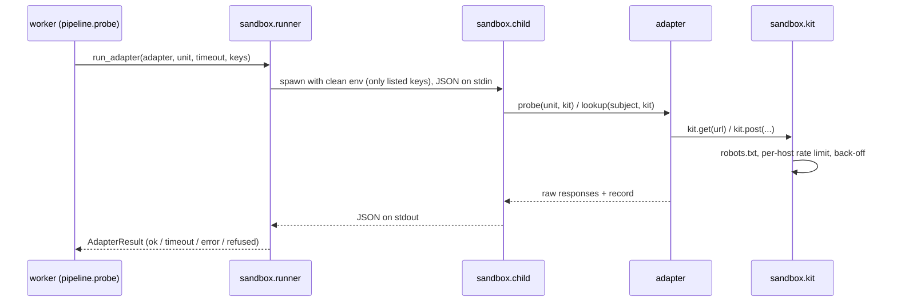

# Sandbox and adapters — `sourcemap.sandbox`, `sourcemap.adapters`

Adapter code never runs in the worker's process (ADR 0008). The worker calls `runner`, which
spawns `child` as a separate Python process; only the child imports adapters.

| Module | Public functions (one line each) |
|---|---|
| `sandbox/runner.py` | `run_adapter(adapter_ref, call, *, timeout_s, env_keys, keys_source) -> AdapterResult` — spawn the child with a clean environment and resource limits, kill at timeout, refuse if the adapter asks for an unlisted key. |
| `sandbox/child.py` | `main()` — read the call from stdin, import the named adapter, run it with a `Kit`, write raw responses + record to stdout. |
| `sandbox/kit.py` (built in stage 2) | `Kit(transport, clock, sleep, min_interval_s=1.0, max_retries=3, timeout_s=30, keys)`; `get(url, params, headers)`, `post(url, body, headers)`, `kit(url)` → `RawResponse(url, status, headers, body)` — robots.txt per host per RFC 9309 (4xx → allowed, 5xx or unreachable → all disallowed), per-host spacing, back-off 1 s, 2 s, 4 s… or `Retry-After` on 429/5xx, `BlockedByRobots`, `FetchError`; body bytes exactly as served; `key(name)` — only listed keys, else `PermissionError`. Standard library only (`urllib`). |
| `adapters/theorg.py` | `probe(unit, kit)` — theorg.com org page(s) → people with title and manager. |
| `adapters/dart.py` | `probe(unit, kit)` — Open DART executive table (임원 현황) from the latest periodic report → executives with title; no `reports_to`. |
| `adapters/linkedin_apify.py` | `probe(unit, kit)` — company employees list; `lookup(subject, kit)` — profile search by name + company → candidates with current position. |
| `adapters/company_page.py` | `probe(unit, kit)` — fetch the company's leadership page(s) listed in the unit's identifiers; extraction to people is done by the worker's judge from the raw HTML (ADR 0006). |
| `adapters/openalex.py` | `probe(unit, kit)` — authors with last-known institution = the unit's institution, filtered by concept/field; `lookup(subject, kit)`. |
| `adapters/orcid.py` | `probe(unit, kit)` — ORCID search by affiliation (ROR) and department keywords; `lookup(subject, kit)`. |
| `adapters/university_directory.py` | `probe(unit, kit)` — fetch the department's people page(s); extraction as for company pages. |
