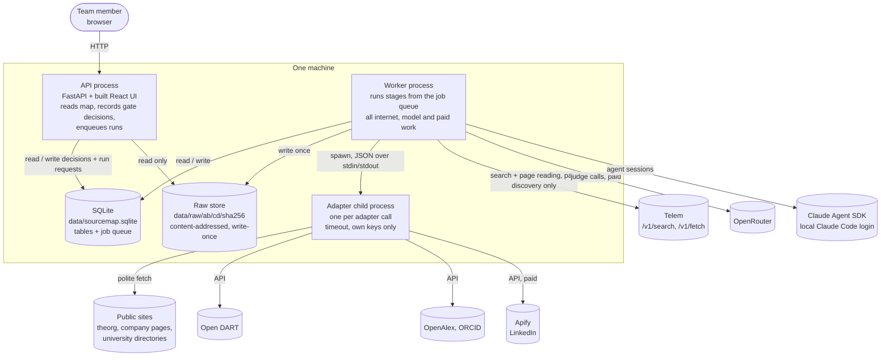

# Containers

Two processes, one database, one file store. Only the worker touches the internet, models or
money. The API and the worker never call each other; they share only the database (and the raw
store, which the API reads but never writes).

## Processes

| Process | Starts with | Does | Never does |
|---|---|---|---|
| **API** | `sourcemap api` | Serves the web UI and JSON endpoints; reads scores, map snapshots, claims, verifications and raw fetches; records gate decisions; inserts run requests (a `run` row + its first `job`). | Call the internet, a model, or spend money. Import worker, adapter or service code (import-linter contract). |
| **Worker** | `sourcemap worker` | Leases jobs from the database and runs stages: discover, probe, match, verify, score, assemble. Charges every paid call to the run budget. Spawns adapter children. Runs a scheduler that enqueues daily maintenance and weekly discovery after publish. | Serve HTTP. Import adapter code into its own process. |
| **Adapter child** | spawned by the worker | Runs one adapter function for one probe unit or one lookup, through the polite fetch helper; returns raw responses and a converted record as JSON. | Touch the database. See keys its source doesn't list. Run past its timeout. |

If the worker is down, the API still serves the last map: everything it shows is in the database
and raw store.

## Stores

| Store | What | Rules |
|---|---|---|
| SQLite `data/sourcemap.sqlite` | All tables (`docs/data-model.md`), including the job queue and the run event log. WAL mode so the API reads while the worker writes. | Schema changes only by migration files in the repo. An agent never changes the schema. |
| Raw store `data/raw/` | Raw fetches, by SHA-256 of their bytes. | Write-once. The same content stored twice is one file. Never edited, never deleted by the product. |
| Judge cache | Rows in `judge_call`, keyed by (model, prompt version, input hash). | The same question is never paid for twice. |

## Outside services

| Service | Used by | For | Not allowed for |
|---|---|---|---|
| Telem | worker (discovery agent tools) | finding sources; reading a site's pages when planning | verifying claims; probe fetches (R2) |
| OpenRouter | worker (judge) | title / name / value comparisons; borderline entity pairs; second-judge calibration | — |
| Claude Agent SDK | worker | discovery agent sessions | anything without structured output |
| Apify (LinkedIn) | adapter child | LinkedIn company people lists and person lookups | — |
| Open DART, OpenAlex, ORCID | adapter child | probe and lookup | — |
| Public websites | adapter child, via polite fetch | probe (theorg, company and university pages) | ignoring robots.txt |
