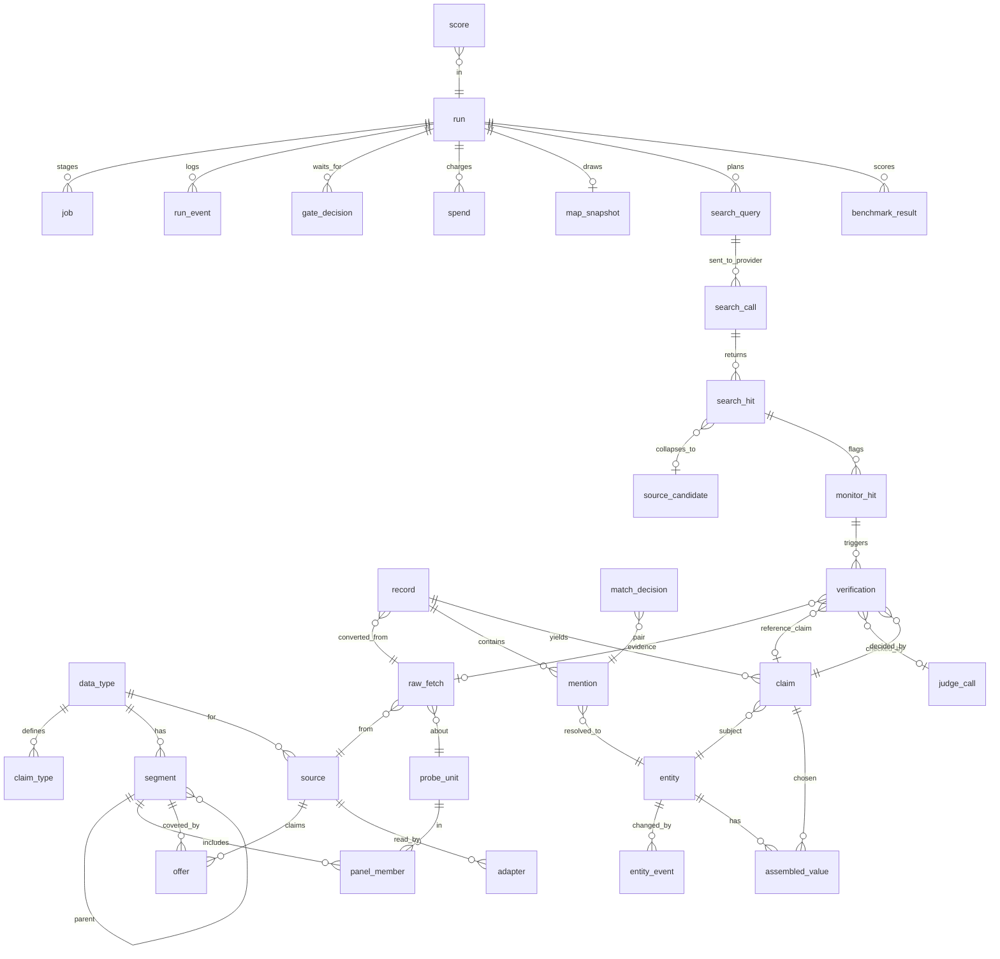

# Data model

SQLite. The migration files under `src/sourcemap/store/migrations/` are authoritative (from
stage 2); this doc is kept in step with them. Seed content (panels, identifiers, known sources)
lives as JSON in `seeds/` and is loaded by `sourcemap seed`.

First-party sources are one source per data type (`company_page`, `university_directory`) with
lineage `company:{domain}` / `university:{domain}`: claims are only ever compared within one probe
unit, so the per-domain lineage of ADR 0005 is the unit's domain.

Records of every data type share the same tables: the shape of a record lives in a versioned JSON
schema stored as data, not as columns (ADR 0001).

## Definitions (setup content)

| Table | Key columns | Notes |
|---|---|---|
| `data_type` | id, slug, name, spec_version, spec_json | `spec_json`: probe unit definition, record JSON schema, claim extraction rules. |
| `claim_type` | id, data_type_id, slug, value_kind (`bool`/`text`/`entity`/`url`/`email`), expiry_days, compare (`exact`/`normalised`/`judge`) | `reports_to` has value_kind `entity`. |
| `segment` | id, data_type_id, parent_id, slug, name, criteria | A tree; each data type has a root `all`. |
| `probe_unit` | id, data_type_id, slug, name, identifiers_json | e.g. `{"theorg":"airtable","domain":"airtable.com","linkedin":"…","dart_corp_code":"…"}`; `{"openalex_institution":"I…","ror":"…","dept_url":"…"}`. |
| `panel_member` | segment_id, probe_unit_id | |
| `identifier_check` | id, probe_unit_id, kind (`theorg`/`linkedin`/`dart`/`ror`/`openalex`/`people_page`), value, result (`ok`/`format_ok`/`mismatch`/`unreachable`/`blocked_by_robots`/`bad_format`/`no_key`), detail, checked_at | From `seed --check-ids`. Only `ok`/`format_ok` identifiers become known answers. |
| `source` | id, data_type_id, slug, name, url, tier, subtype, lineage, lineage_by_claim_json, access, status (`proposed`/`approved`/`rejected`/`retired`), can_verify_json, found_by_json | `found_by_json`: which search provider and query found it (discovery provenance). |
| `offer` | source_id, segment_id, state (`hypothesis`/`measured`) | |
| `adapter` | id, source_id, version, module, keys_json, supports_lookup, status | Hand-written in the demo; `keys_json` lists the only env keys the child receives. |

## Runs and jobs

| Table | Key columns | Notes |
|---|---|---|
| `run` | id, data_type_id, kind (`setup`/`maintenance`/`discovery`/`benchmark`), mode (`test`/`real`), as_of, scenario, budget_usd, spent_usd, status (`queued`/`running`/`waiting_gate`/`done`/`failed`/`cancelled`/`out_of_budget`), settings_json, created_at | `as_of` is the run's clock. `scenario` is null in the real database and always set in a simulation database (ADR 0014). |
| `job` | id, run_id, stage, seq, status (`queued`/`running`/`done`/`failed`), lease_until, attempts, error, started_at, finished_at | The queue. A stage is idempotent; restart re-runs it and skips work already stored. |
| `gate_decision` | id, run_id, gate (`B`/`D`), decision (`approve`/`reject`), payload_json, note, decided_at | Written by the API. |
| `run_event` | id, run_id, at, level, stage, message, data_json | The live log. |
| `spend` | id, run_id, service, units, usd, ref, at | Every paid call; `run.spent_usd` is their sum. |
| `agent_session` | id, run_id, purpose, cost_usd, turns, status, output_json | Capped by count per run. |
| `schedule` | id, data_type_id, kind (`maintenance`), cron, enabled | Created on publish (gate D approved). Discovery is not scheduled in the demo. |

## Evidence chain

| Table | Key columns | Notes |
|---|---|---|
| `raw_fetch` | id, run_id, source_id, probe_unit_id, kind (`probe`/`lookup`), request_json, url, status_code, content_type, sha256, size, fetched_at, error, simulated, derived_from_raw_fetch_id, sim_patch_json | Bytes in the raw store at `sha256`. Never updated. `simulated` is 0 in the real database; a fabricated fetch (simulation database only) has 1, the real fetch it was edited from, and the exact edit (ADR 0014). |
| `record` | id, raw_fetch_ids_json, source_id, probe_unit_id, run_id, schema_version, payload_json, valid, errors_json, extracted_by_judge_call_id | One source's converted answer for one probe unit in one run. `extracted_by_judge_call_id` is set when a judge extracted it from a first-party page (ADR 0006). |
| `mention` | id, record_id, local_ref, name, name_norm, identifiers_json, attrs_json | One person inside one record. |
| `entity` | id, data_type_id, probe_unit_id, display_name, created_run_id, merged_into_id | Ids are stable across runs and never reused; a merged-away entity points at its survivor (ADR 0013). |
| `entity_event` | id, run_id, kind (`create`/`merge`/`split`), entity_id, other_entity_id, mention_ids_json, reason, match_decision_id | Audit trail of matching changes. |
| `mention_entity` | mention_id, entity_id, method (`identifier`/`rule`/`judge`), match_decision_id | |
| `match_decision` | id, mention_a_id, mention_b_id, decision (`same`/`different`), method, reason, judge_call_id | `different` is a cannot-link constraint. |
| `claim` | id, data_type_id, source_id, probe_unit_id, claim_type_id, subject_entity_id, object_entity_id, value_json, value_norm, fingerprint, first_record_id, first_seen_run_id, last_seen_run_id | `fingerprint` = (source, unit, subject entity, claim type, value_norm). An unchanged claim keeps its row across runs; a changed value is a new claim. |
| `claim_record` | claim_id, record_id | Which records stated the claim (all runs). |
| `verification` | id, claim_id, run_id, method (`reference`/`lookup`/`agreement`), verdict (`correct`/`wrong`/`stale`/`unverifiable`), weight, evidence_raw_fetch_id, reference_claim_id, judge_call_id, quote, reason, decided_at, expires_at, trigger_monitor_hit_id | Never updated; a re-check adds a new row. The current verdict of a claim is the strongest unexpired one (R7). |
| `judge_call` | id, model, prompt_version, input_hash, input_json, output_json, usd, created_at | Also the judge cache. |

## Scores and map

| Table | Key columns | Notes |
|---|---|---|
| `source_health` | run_id, source_id, state (`ok`/`degraded`/`broken`/`shape_changed`/`changed`), details_json | |
| `score` | id, run_id, source_id, segment_id, claim_type_id, coverage_state (`measured`/`not_probed`/`failed`), units_covered, units_panel, entities, units_failed, n_correct, n_wrong, n_stale, n_unverifiable, n_decisive, n_weighted, prior_a, prior_b, post_a, post_b, mean, lo90, hi90, accuracy_state (`measured`/`not_enough_data`/`unmeasured`), gate_json, freshness_days | One row per cell per run: the history. |
| `map_snapshot` | id, run_id, data_type_id, created_at, combos_json, gaps_json | Best combination of up to 3 sources per segment and gap flags. |
| `alert` | id, run_id, kind (`drift`/`broken`/`shape_changed`), source_id, segment_id, claim_type_id, details_json | |
| `score_verification` | score_id, verification_id | The exact verdicts a score used — makes R10 a join, not a re-computation. |

## Search: benchmark and monitor (ADR 0015, 0016)

| Table | Key columns | Notes |
|---|---|---|
| `search_query` | id, run_id, data_type_id, segment_id, category, text, purpose (`discovery`/`benchmark`/`monitor`/`people_page`) | The fixed query plan of a benchmark is these rows. |
| `search_call` | id, query_id, provider, routing (`pinned`/`auto`), num_results, status, usd, latency_ms, at | One row per query × provider. Charged to `spend`. |
| `search_hit` | id, call_id, rank, url, domain, title, snippet, candidate_id | Search results. **Never evidence**: no foreign key from `verification` points here. |
| `source_candidate` | id, data_type_id, domain, url_prefix, known_source_id, in_review_sample, review (`keep`/`reject`/`pending`/`not_sampled`), reviewed_blind, source_id | Hits collapsed by domain + path. `known_source_id` set when it is a seed source. At most ~80 per data type are sampled for review. |
| `known_answer_trial` | id, run_id, probe_unit_id, target (`theorg`/`linkedin`/`ror`/`people_page`), query_id, provider, expected_url, found_rank, hit | One row per (unit, target, provider); scored automatically against the seed. |
| `benchmark_result` | id, run_id, provider, segment_id, metric (`known_hit_rate`/`known_mrr`/`precision`/`pooled_recall`/`known_recall`/`exclusive`/`usd_per_good_find`/`latency_ms`), num, den, mean, lo90, hi90, state | The leaderboard. |
| `monitor_hit` | id, run_id, probe_unit_id, hit_id, matched_entity_id, recheck_claim_ids_json | Links a news hit to the re-checks it triggered; outcome is read from the triggered verifications. |

## Assembly

| Table | Key columns | Notes |
|---|---|---|
| `assembled_value` | id, run_id, entity_id, claim_type_id, chosen_claim_id, alternatives_json, reason_json | `reason_json`: e.g. `{"winner":"company:gong.io","acc":0.92,"loser":"theorg","acc":0.71,"segment":"na_mid"}`. |

## The trace (R10)

`score` → `score_verification` → `verification` → `claim` (→ `claim_record` → `record` →
`raw_fetch` of the claim) and `verification.evidence_raw_fetch_id` / `reference_claim_id` (the
evidence). All links are foreign keys.
