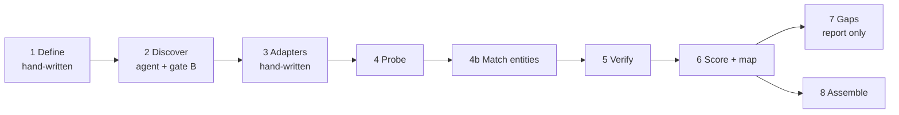

# Domain

This is the source of truth for what sourcemap does. Code and tests follow this file. If they
disagree with it, that is a bug.

---

## 1. The problem

Some data is needed again and again, for many entities, over a long time: who runs each target
company and who reports to whom; who the people in a university department are. The internet
holds it, but scattered. Each source covers part of the world, is right some of the time, and
changes or breaks without notice. Today someone finds out by hand which source is good for what,
once, and the answer goes stale.

sourcemap keeps that answer current, with evidence. The output is a **map**: rows are segments,
columns are sources, and each cell says how much the source covers and how accurate it is, with
an honest interval. Every number opens up to the checks behind it, and every check to a saved
copy of what a source returned.

**The product's value is its accuracy numbers.** A number nobody can trace is worthless. An honest
"we don't know" beats a confident guess.

Users: a small, technical team that wants to rely on data and see why.

---

## 2. Vocabulary

These words are used unchanged in code, docs and UI.

| Word | Meaning | Example |
|---|---|---|
| **Data type** | A kind of data, defined precisely enough to test. | *org chart*, *academic identity* |
| **Probe unit** | What a source is asked about. One probe unit yields many statements. | org chart: the company *Airtable*; academic identity: *Purdue · Computer Science* |
| **Segment** | A group of probe units where source quality is probably similar. Segments form a tree under a root "all". The UI calls them ICP. | *US large companies*; *US R1 CS departments* |
| **Panel** | The probe units of a segment that sources are tested on. | Apple, Microsoft, Intel, Salesforce |
| **Source** | A place data comes from, at the level where access and quality are uniform. | *theorg.com org pages*; *DART executive tables* |
| **Tier / subtype** | How much we trust a source *before* measuring it (§5). | theorg: tier 3, crowd edited |
| **Lineage** | Where a source's data really comes from. Same lineage = copies. | ZoomInfo and LinkedIn: both `linkedin` |
| **Offer** | A source's claim that it covers a segment. A hypothesis until measured. | "theorg covers US mid-size" |
| **Adapter** | Code that reads one source: fetch raw data for a probe unit and convert it; for some sources, look up one subject. | `theorg` adapter |
| **Raw fetch** | Exactly what a source returned, at a time, kept forever unchanged. Also called a **snapshot**. | the HTML of theorg.com/org/airtable on 2026-11-14 |
| **Record** | One source's converted answer for one probe unit. | theorg's list of 140 Airtable people |
| **Mention** | One person as they appear inside one record. | "Howie Liu, CEO" in theorg's Airtable record |
| **Entity** | One real person, after matching mentions across sources. | the Howie Liu that theorg, LinkedIn and airtable.com all mention |
| **Claim** | One checkable statement inside a record. **Claims, not records, are checked and scored.** | *Howie Liu works at Airtable*; *his title is CEO* |
| **Claim type** | A kind of claim, defined per data type. | employment, title, reports_to |
| **Verification** | A verdict on one claim — `correct`, `wrong`, `stale`, `unverifiable` — with its method and evidence. | `correct` by lookup, evidence = LinkedIn raw fetch #812 |
| **Verifier source** | A source allowed to check a claim type by looking up one subject. | LinkedIn via Apify for employment and title |
| **Judge** | A cheap single model call that compares two values or two mentions. Not an agent. | "Is *VP, Sales* the same title as *Vice President of Sales*?" |
| **Score** | For one (source, segment, claim type): coverage, accuracy interval, n checked, stale and unverifiable shares, freshness. Kept as history. | theorg · US mid-size · title: coverage 4/4, accuracy 0.71 [0.55, 0.84], n = 23 |
| **Map** | All current scores of a data type, segments × sources, one view per claim type. | |
| **Assembled dataset** | One entry per entity, each value taken from the most trusted source for it, with every alternative kept. | |
| **Run** | One pass of the pipeline. | maintenance run #7 |
| **Gate** | A point where a run waits for a person to approve. | gate B: approve discovered sources |

---

## 3. Starting content

### Org chart

- **Probe unit:** a company. **Claim types:** `employment` (P works at C), `title` (P's title is T),
  `reports_to` (P reports to M). Every data type also has the claim type `exists`
  (this person is real and at this probe unit), which `employment` plays for org charts.
- **Segments and panel:**

| Segment | Panel |
|---|---|
| North American mid-size (200–5,000 staff) | Airtable, Gong, Ramp, Notion |
| US large (5,000+) | Apple, Microsoft, Intel, Salesforce |
| Korean listed | Samsung Electronics, SK hynix, LG Electronics, Naver |
| European mid-size | Contentsquare, Mirakl, Personio, Pennylane |

- **Sources:**

| Source | Tier / subtype | Lineage | Covers | Can verify |
|---|---|---|---|---|
| theorg.com | 3 crowd edited | `theorg` | all | — |
| Open DART executive tables | 1 official filing | `dart` | Korean listed | employment, title (Korea) |
| LinkedIn via Apify | 4 profile aggregate | `linkedin` | all | employment, title (by lookup) |
| Company leadership pages | 2 first party | `company:<domain>` | all | employment, title of listed people |

DART has no manager field: any `reports_to` derived from it would be *our* derivation, so DART
makes no `reports_to` claims. `reports_to` will mostly be unverifiable in the demo; the map says so.

### Academic identity

- **Probe unit:** institution + department. **Claim types:** `exists`, `role` (PhD student,
  professor…), `affiliation` (currently at this department), `email`, `profile_link`.
- **Segments and panel:**

| Segment | Panel |
|---|---|
| US R1 CS | Stanford, MIT, CMU, UIUC, Purdue (CS) |
| US R1 other fields | Stanford economics, MIT physics, Purdue mech. eng., UIUC chemistry |
| US teaching institutions | Truman biology, Williams economics, NSU biology, Truman CS |
| International | KAIST CS, SNU economics, ETH CS, Sorbonne physics |

- **Sources:**

| Source | Tier / subtype | Lineage | Can verify |
|---|---|---|---|
| OpenAlex | 3 bibliographic | `openalex` (from publications) | exists, affiliation |
| ORCID | 3 bibliographic | `orcid` (self-reported) | exists, affiliation, profile_link |
| University directory pages | 2 first party | `university:<domain>` | exists, role, affiliation, email |

OpenAlex uses ORCID iDs to tell authors apart, so for `profile_link` (the ORCID iD itself) the two
share lineage. For affiliation they don't: OpenAlex takes it from papers, ORCID from the person.
Lineage is recorded **per claim type** where it differs (ADR 0005).

**Targets:** coverage 50%, accuracy 80%, for both data types.

---

## 4. The pipeline

A **run** is a chain of stages. In the demo, setup steps 1 and 3 are done by hand (hand-written
spec and adapters); the agents of the full product for those steps are out of scope.

### Step 1 — Define the data type
A spec: what a probe unit is, the shape of one record (a versioned JSON schema), the claim types
with a rule that pulls claims out of a record, and the segment tree. Records of every data type
live in the same tables; adding a data type never changes the database (ADR 0001).
*Example:* the org-chart record schema v1 says a record is a list of people, each with `name`,
`title`, optional `manager_ref`, optional `identifiers` (e.g. a LinkedIn URL).

### Step 2 — Discover sources
An agent first plans **categories of publishers** (regulators per country, the subjects' own pages,
curated databases, bibliographic indexes, job boards), then searches each category separately.
It returns source cards: name, URL, tier/subtype, lineage, access, segments, claim types it could
verify, why, and which search provider found it. Sources needing a paid contract or forbidding
automated access are skipped. A person approves which to keep (**gate B**) and can add sources
by hand. Web search is allowed here, and only to *find* sources.

**A kept source with no adapter** (the demo writes adapters by hand, not with agents): it is saved
as `approved` with its offers as hypotheses, appears as a column on the map with every offered cell
in the state **not probed — no adapter** (never 0%), and is listed in the run report under "needs
an adapter". It is probed only after someone writes its adapter.

### Step 3 — Adapters
Hand-written for the demo. Each adapter runs in an isolated child process with a timeout, only
its own keys, and a shared polite fetch helper (robots.txt, rate limits, back-off) (ADR 0008).

### Step 4 — Probe
Fetch every approved source for the panel units of the segments it offers. Keep every raw fetch
unchanged; convert to records; pull out claims; record each source's **health**. One source
failing never stops the run. Fetches younger than the reuse window may be reused to save money.

### Step 4b — Match entities
Turn mentions into entities **before** verifying, so claims are compared per person, not per name
string (ADR 0004). *Example:* theorg's "J. Smith, VP Sales" and gong.io's "Jane Smith, Vice
President of Sales" at Gong become one entity; the `title` claims of both now point at it.

### Step 5 — Verify
Give claims verdicts, with evidence, by these methods, strongest first (ADR 0003):

1. **Reference match** — compare with a tier-1 or tier-2 source of a different lineage that covers
   the same entity. *Example:* DART says 한종희 is 대표이사 (CEO) of Samsung Electronics; theorg's
   title claim for the same entity is judged against it.
2. **Verifier lookup + judge** — for a *sample* of claims, look the subject up in a verifier source
   of a different lineage, keep the response as a raw fetch, and let the judge compare.
   *Example:* theorg says Jane Smith is VP Sales at Gong; the LinkedIn lookup returns her profile;
   the judge says the titles match → `correct`.
3. **Agreement** — two sources of different lineages say the same thing. Weak, because sources
   copy each other. *Example:* theorg and gong.io both list Jane Smith → agreement on employment.

Sampling puts lookups where uncertainty is largest (widest intervals first). If no verifier
exists for a claim type in a segment, the cell says "stays unmeasured". A claim is never paid for
twice while its verdict is valid.

### Step 6 — Score and draw the map
Per (source, segment, claim type): coverage, accuracy interval, n, stale and unverifiable shares,
freshness. Per segment: the best combination of up to 3 sources and whether the segment is a
**gap** (below the coverage target). Scores and a map snapshot are kept for every run.

### Step 7 — Gaps
For gap segments, the demo lists them on the map and in the run report. (The full product's
gap agent and gate C are out of scope.)

### Step 8 — Assemble
One entry per entity; each field from the source most accurate *for that claim type in that
segment*; every alternative value kept with its origin and the reason it lost.

**Gate D** — the only place it occurs: at the end of a **setup** run, after assembly, a person
checks a sample of assembled entries and approves or rejects. Approving **publishes** the data type,
which turns on daily maintenance. Maintenance runs assemble too, but never stop at a gate.
*Example:* "title: *Vice President of Sales* — from gong.io (title accuracy 0.92 in NA mid-size)
over theorg *VP Sales* (0.71)".

### Kinds of run

| Kind | Steps | Gates | Agents |
|---|---|---|---|
| **Setup** | discover → gate B → probe → match → verify → score → assemble → gate D | B, D | discovery |
| **Maintenance** (daily, scheduled after publish) | probe → match → verify → score → assemble | none | none |
| **Discovery** (on demand only; not scheduled in the demo) | discover → gate B → probe and measure sources that have adapters, on trial | B | discovery |
| **Benchmark** (on demand) | plan queries once → send them to every search provider → pool candidates → blind gate B → score providers (§11) | B | discovery (query plan only) |

**Test vs real mode** differ only in settings: test uses ~3 units per segment, few lookups and a
~$6 budget; real uses the full panel and ~$15. The demo total stays under $20; any single run over
$5 asks first. Code paths are the same.

**Simulated days** (ADR 0014). Every run has an `as_of` date. The drift demo runs **scenarios** —
a person leaves, a source breaks — in a **copy** of the database (`data/sim/<scenario>.sqlite`),
never in the real one. Fabricated snapshots are edited copies of real ones, flagged
`simulated` with the exact edit recorded. Each simulated run is one day later. The UI shows a
simulation only when explicitly opened, under a permanent "SIMULATION" banner, and never exports it.
Simulated data never enters the real map, history or assembled dataset.

*Example — a departure:* the scenario says Gong's VP Sales left on 1 Dec. From then on, the
simulated LinkedIn lookup for her is the stored real response with the Gong position given an end
date, and the simulated gong.io page is the stored one without her. The next simulated day forces
her claims into the re-check set; the lookup verdict becomes `stale`; the cell's stale share rises
and its accuracy moves; the history marks the day.

---

## 5. Source tiers

| Tier | Subtype | Examples | Typical failure | Prior (ADR 0002) |
|---|---|---|---|---|
| 1 | official filing | DART, SEC | out of date; our derivation from it is wrong | Beta(4, 1) |
| 2 | first party | company team page, university directory | incomplete, layout changes | Beta(3, 1) |
| 3 | researched / crowd edited / bibliographic | theorg, OpenAlex, ORCID | shallow, uneven, stale, name ambiguity | Beta(2, 1) |
| 4 | profile aggregate / inferred | LinkedIn via Apify; ZoomInfo; AI-written pages | circular; invented plausible relations | Beta(1, 1) |

Trust comes from where data is published (a government domain, the subject's own site, a known
provider), not from how it looks.

---

## 6. The accuracy rules (fixed)

Each rule has an example. Stage 1's case table tests every one.

**R1. Accuracy is per claim type and per segment.** Never one number per source.
*Example:* theorg is 0.95 on employment and 0.30 on reports_to in NA mid-size — two cells.

**R2. Web search finds; it never proves.** Search results (and Telem fetch renderings) are never
evidence. Evidence is always a raw fetch from a named source, kept.
*Example:* a Google snippet "Jane Smith, VP Sales at Gong" cannot make a verdict. The LinkedIn
profile fetched through Apify and stored can.

**R3. Plausible is not correct.** A claim that fits the structure is not evidence.
*Example:* "Director of Sales reports to VP Sales" looks right; without a source that states it,
the verdict is `unverifiable`.

**R4. Same lineage never verifies itself; agreement between copies counts once.**
*Example:* a ZoomInfo title can't be checked by LinkedIn (both lineage `linkedin`). If ZoomInfo
and Apollo (both `linkedin`) agree with each other, that is no agreement at all.

**R5. Overlap does not automatically transfer.** If a source matches a reference on the part they
share, that accuracy applies to the rest of the source only if the rest looks like the shared
part. The **representativeness gate** compares the overlap and the rest on: share of fields
filled, depth in the org tree, freshness, and value formats. If the gate fails, verdicts on the
overlap are dropped from the source's estimate for that cell, and the rest must be sampled by
lookup.
*Example:* theorg matches DART on Samsung's 27 executives. The other 3,000 theorg Samsung people
sit deeper in the tree and have fewer titles filled → gate fails → the 27 verdicts don't count for
the cell; lookups sample the rest.

**R6. Accuracy is an interval.** A Beta posterior with a weak prior by tier (§5), reported as mean
and a 90% equal-tailed interval with n.
*Example:* crowd edited, prior Beta(2, 1), 3 correct → Beta(5, 1) → mean 5/6 = 0.83, 90%
interval about [0.55, 0.99]. Not "100%".

**R7. One verdict per claim; the strongest method wins.** Reference > lookup > agreement.
Agreement counts as half a check (weight 0.5), and counts nothing for tier-4 inferred sources.
*Example:* a claim with a `correct` agreement and a `wrong` lookup is `wrong`.

**R8. Stale is not wrong; unverifiable is not wrong.** Both are counted and shown as shares;
neither enters accuracy. With no decisive check, accuracy is **unmeasured** — the prior is never
displayed. With fewer than **5** decisive checks (agreement counting 0.5 each), the cell says
**not enough data** and shows the interval only (ADR 0002).
*Example:* 2 correct + 1 stale + 1 unverifiable → n = 2, stale share 25%, unverifiable share 25%,
"not enough data".

**R9. Official sources are spot-checked too.** Our derivation from them can be wrong.
*Example:* a sample of DART-derived titles is looked up on LinkedIn every run.

**R10. Every accuracy number is traceable:** score → verifications → claim → raw fetch of the claim
→ raw fetch of the evidence. Each link is clickable in the UI; the drill-down from a map cell to
a raw fetch takes at most 3 clicks.

### Coverage

- Per (source, segment): the share of panel units for which the source returned at least one
  valid record. Per claim type: the share of units with at least one claim of that type.
- **States:** *measured* (a percentage), *not probed* (no adapter, not offered, or never fetched),
  *failed* (the fetch broke this run). Untested is never shown as 0%.
- A combination of sources counts **unique entities** (after matching), so two sources returning
  the same 30 people do not add up to 60.
- An empty segment is a valid result and is shown.

---

## 7. Ground truth without humans

There is no human-labelled gold set (ADR 0003). Truth comes from the methods in step 5. Two
automated things could be wrong unnoticed, so each is measured another way and shown:

- **The judge.** (a) A fixed set of easy cases with known answers (identical titles, translations
  like 대표이사 = CEO, clearly different people) must all pass; (b) a second model from another
  family re-judges a sample, and the two judges' agreement rate is shown. The UI says
  "judge error: not measured against humans".
- **Entity matching.** Shared identifiers (LinkedIn URL, ORCID iD) give pairs whose answer is
  known. The matcher is scored on them without using the identifier; false and missed merges are
  shown.

---

## 8. Matching entities

Within one probe unit only. Names are normalised: Unicode-folded, accents removed, honorifics and
suffixes dropped (Dr., Prof., Jr., PhD), "Last, First" reordered, hyphens and case ignored,
tokens sorted.

| Pair | Decision | Why |
|---|---|---|
| "Park, Hyung-Kwan" / "HYUNG KWAN PARK" | same | identical after normalising |
| "Dr. Jane Smith" / "Jane Smith" | same | honorific dropped |
| "J. Smith" / "Jane Smith" | judge | initial compatible; judge sees titles too |
| "John Smith" / "Jane Smith" | different | given names differ |
| "박형관" / "Hyung-Kwan Park" | judge | different scripts; rules can't decide |
| any two with the same LinkedIn URL | same | shared identifier |

The judge only sees borderline pairs. A pair the judge calls different is **never** merged, even
through a third mention (cannot-link constraints). Matching quality is measured (§7).

**Entity ids are stable across runs** (ADR 0013). Claim fingerprints contain the entity id, so a new
run first attaches mentions to existing entities (shared identifier, same source's previous
mention, same normalised name, then the judge) and creates an entity only when nothing matches.
Ids are never reused. A merge keeps the older id; a split moves mentions to a new entity and
invalidates the reference and agreement verdicts that relied on the wrong merge. Both are logged.
*Example:* theorg returns the same 140 Airtable people tomorrow → same entities → same fingerprints
→ yesterday's valid verdicts still count, nothing is paid twice.

---

## 9. Drift and freshness

- **Health per source per run**, compared with its previous run:
  `ok`; `degraded` (some units failed); `broken` (nothing returned); `shape_changed` (the parser
  fails on many pages); `changed` (many values differ from last time).
- **Verdicts expire:** title and reports_to after 30 days, employment and affiliation after 60,
  role after 90, exists after 180 (ADR 0012). An expired verdict leaves the score. Each run re-checks a share of the oldest
  verdicts before they expire, so a person who left eventually shows `stale` even if the source
  never changed.
- **Accuracy drift alert:** fires when a cell's new 90% interval does not overlap its previous one.
- **History:** per cell, coverage and accuracy over runs, with breakages and alerts marked.

---

## 10. Search-provider benchmark (the demo's centrepiece)

sourcemap measures which source is good for what. The benchmark applies the same method to the
search providers behind Telem: **which provider is good at finding sources, for which segment**
(ADR 0015).

1. The discovery agent plans publisher categories and writes the queries **once**.
2. The same fixed queries go to every provider pinned on its own, and to Telem's automatic routing,
   with the same number of results.
3. Hits collapse into **candidates** by domain and path; each candidate remembers which providers,
   ranks and queries found it.
4. **Good finds** = known sources from the seed (automatic) + candidates the user keeps at gate B.
   Gate B is **blind**: candidates are shown without which provider found them.
5. Each provider gets, per segment: precision, pooled recall, known-source recall, exclusive finds,
   cost per good find, latency — proportions as Beta(1, 1) intervals with n, "not enough data"
   under 5 trials, "failed" when the provider errored. Later: the measured coverage and accuracy of
   the sources it found.

*Example:* for "Korean listed", provider A surfaces DART and 3 kept candidates out of 15 proposed
(precision 0.25 [0.10, 0.45]); provider B surfaces none of them. The leaderboard shows A ahead for
that segment only.

Limit, stated on the leaderboard: pooled recall only knows what *some* provider found.

---

## 11. Change monitor

Each daily maintenance run makes one news search per company for the last 7 days (appoints, joins,
leaves…). If a hit names a person we track at that company, that person's employment and title
claims jump to the front of the re-check queue (ADR 0016). **The news never decides a verdict**
(R2): the re-check's lookup or reference does, and the drill-down says "re-check triggered by a
news hit".

*Example:* a hit "Gong's VP Sales Jane Smith steps down" → her claims are re-checked that day → the
LinkedIn lookup shows the position ended → `stale`.

In the demo this is shown as **how it works plus any real case caught** — not as a measured hit
rate. Counts stay raw with "too few to measure" until triggered and random re-checks can be compared.

---

## 12. Money

Every paid call (Telem, OpenRouter, Apify) is charged to the run's budget before it is made. A
run stops cleanly when its budget is spent. Agent sessions are capped by count as well as
dollars, because a failed session can report $0.
