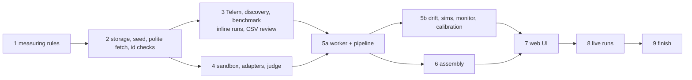

# Plan

The build in stages. Each stage file says the **goal**, **what gets built**, the **order of work**,
and **how you check it**. A stage is done only when every check passes and the user says go.

| Stage | File | Status |
|---|---|---|
| 0 | [Design on paper](stage-0-design.md) | done, awaiting approval |
| 1 | [Measuring rules, offline](stage-1-measuring-rules.md) | next |
| 2 | [Storage, starting content and identifier checks](stage-2-storage-and-seed.md) | — |
| 3 | [Discovery and the search-provider benchmark](stage-3-discovery-and-benchmark.md) — **centrepiece** | — |
| 4 | [Reading sources safely, and the judge](stage-4-reading-sources.md) | — |
| 5a | [The daily pipeline: run, trace, resume](stage-5a-pipeline.md) | — |
| 5b | [Drift, simulations, change monitor, calibration](stage-5b-drift-and-monitor.md) | — |
| 6 | [Assembly](stage-6-assembly.md) | — |
| 7 | [Web UI](stage-7-web-ui.md) | — |
| 8 | [First live runs](stage-8-live-runs.md) | — |
| 9 | [Finish](stage-9-finish.md) | — |

Scope and the user's decisions: see `docs/agent/log.md` (both data types, 4 org-chart segments incl.
Korean listed, no human gold set, Telem for search, the search-provider benchmark as centrepiece
and the change monitor second). Rules: `docs/domain.md`.

## Dependencies

Stage 3 needs no worker (runs inline from the CLI with the same jobs), no judge (candidates collapse
by domain) and no UI (blind review by CSV or terminal). The judge is built in stage 4, where
first-party extraction first needs it.

## What you provide and what it costs

| Stage | You provide | Estimated cost |
|---|---|---|
| 0 | Review of the docs | $0 |
| 1 | OK for Python 3.13 only if 3.15 packages fail; read the case table | $0 |
| 2 | `OPENDART_API_KEY`; decisions on failed identifiers | $0 |
| 3 | `TELEM_API_KEY`; approve the plan's cost if > $5; blind review ≤ 80 candidates per data type (~10–15 min each) | $3–5 |
| 4 | `APIFY_TOKEN`, `OPENROUTER_API_KEY`; one real person for a lookup; browser spot-checks | ~$1 |
| 5a | Approve runs > $5; judge one traced verdict | $4–6 |
| 5b | Optionally pick the departure-scenario person | ~$1 |
| 6 | Gate D: look over ~10 assembled entries | ~$0.10 |
| 7 | Browser checks | $0 |
| 8 | Approvals; access to Apify/OpenRouter/Telem dashboards | $5–7 (+$3–5 for a fresh benchmark) |
| 9 | Someone to follow the README from scratch | ~$1 |
| **Total** | | **≈ $15–21** |

The total is close to the $20 demo budget. To stay under it, stage 8 re-scores stage 3's cached
benchmark instead of re-running it, and if Telem's real prices are higher than estimated, the open
discovery task is trimmed first (never the known-answer trials). Agent sessions run on the Claude
Code login and are not in these numbers.

## Order of work inside every stage

1. **Docs first** — update `docs/domain.md`, `docs/data-model.md`, `docs/containers.md` and the
   affected `docs/components/*.md` to describe what is about to be built; ADR for any real decision.
2. **Tests next** — rules as readable case tables (inputs → expected) before the code.
3. **Code** until the tests pass.
4. **Component docs** brought in line with the real modules and functions.
5. **Checks** — fast test suite, import-linter, the stage's own checks; commands and output shown.
6. **Session log** in `docs/agent/log.md`.
7. **Commit** with a clean `git status`, no `.env` or data files.
8. **Stop and wait** for the user.

## Checks for every stage

- [ ] **Tests pass** — "run the full fast test suite and show me the summary line". The count only goes up.
- [ ] **Layering holds** — "run the import-linter check": no broken contracts.
- [ ] **Docs match** — "which docs did you change in this stage?" New behaviour without a doc change is a red flag.
- [ ] **Decisions recorded** — "which decisions did you make, and where are the ADRs?"
- [ ] **Log written** — `docs/agent/log.md` has an entry for this stage.
- [ ] **Clean commit** — `git status` clean; `git log --stat -3` shows no `.env` or data files.
- [ ] **You can explain it** — in two sentences, what the stage added and how data flows through it.

**Red flags:** "tests skipped" without a reason; a rule from `docs/domain.md` §6 quietly weakened;
secrets in output; "done" without command output.

## Money

Total demo spend under about **$20**. The agent asks before any run over **$5**, any real-mode run,
anything near the Apify monthly cap, deleting data, or deploying.
